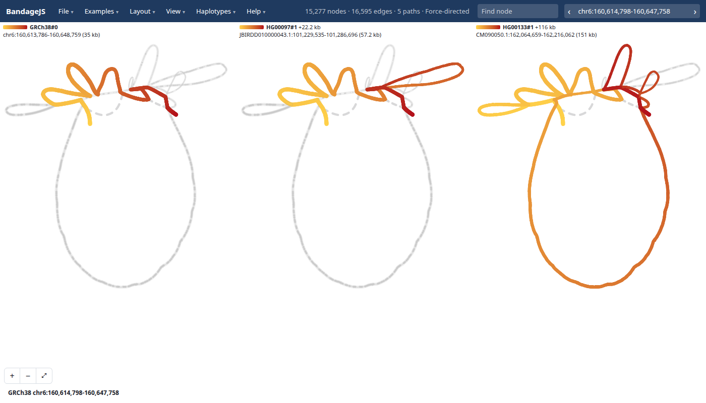

# BandageJS

Browser viewer for pangenome graphs, at https://jbrowse.org/demos/bandagejs/

- **Built for:** pangenomes. Haplotype walks, bubbles, genes and regions cut
  from a walk file are first-class
- **Also opens:** de novo assembly graphs, as
  [Bandage](https://github.com/rrwick/Bandage) does

- **In:** a GFA (plain or gzipped), or a region cut live from a pangenome
- **Out:** a force-directed, anchored or tube-map drawing with haplotypes,
  bubbles and genes marked

## Using it

- **Open** a GFA with File → Open, a url, or drag and drop
- **Cut** a region from a [walk file](docs/walk-files.md), as in
  [this HPRC example](https://jbrowse.org/demos/bandagejs/?walks=hprc&loc=chr6:160,614,798-160,647,758&haps=HG00097,HG00133)
- **Explore** by clicking nodes, searching regions or genes (`g`), and switching
  [layouts](docs/layouts.md) or [haplotype](docs/haplotypes.md) highlights
- **Share** with File → Copy link, or export an SVG

## Docs

- [Haplotypes](docs/haplotypes.md): highlighting walks, panels and rows
- [Layouts](docs/layouts.md): each layout, what it needs and its settings
- [Genes](docs/genes.md): gene tracks, assemblies and site setup
- [Links](docs/links.md): every address parameter
- [Walk files](docs/walk-files.md): gfa-to-tabix to a cut, step by step
- [Gallery](docs/gallery.md): example figures
- [Developing](docs/developing.md): build, test, screenshots and deploy

## See also

- [jbrowse-plugin-graphgenomeviewer](https://github.com/GMOD/jbrowse-plugin-graphgenomeviewer):
  the JBrowse 2 plugin for these graphs
- [HPRC tutorial](https://jbrowse.org/jb2/docs/tutorials/pangenome_hprc/)

## Libraries

- [@jbrowse/bandage-core](https://github.com/GMOD/bandage-core) (npm): layout
  and drawing
- [@jbrowse/graph-stress-layout](https://github.com/GMOD/graph-stress-layout)
  (npm): stress layout
- [@gmod/gbz-base](https://github.com/GMOD/gbz-base-js) (npm): `.gbz.db` reader
- [@jbrowse/graph-walks](https://github.com/GMOD/graph-walks) (npm): walk file
  reader
- [gfa-to-tabix](https://github.com/GMOD/gfa-to-tabix): writes walk files
- [ggbandage](https://github.com/GMOD/ggbandage) (R): Bandage-style figures as
  ggplot2 layers

## License

GPL-3.0-or-later, building on [BandageNG](https://github.com/asl/BandageNG) and
[OGDF](https://www.ogdf.uni-osnabrueck.de/)
