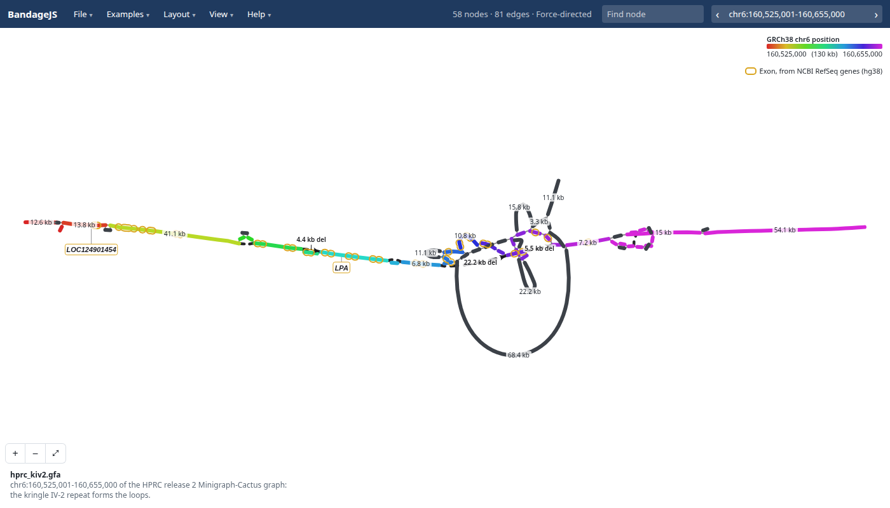
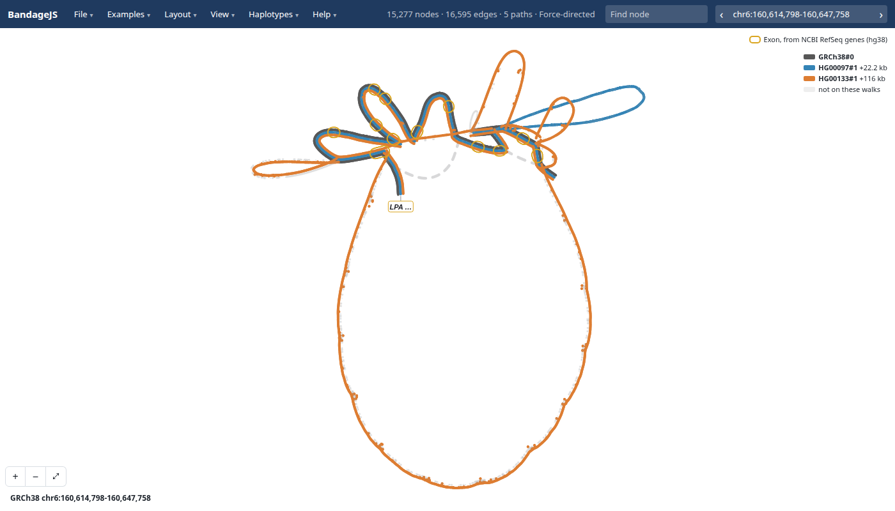
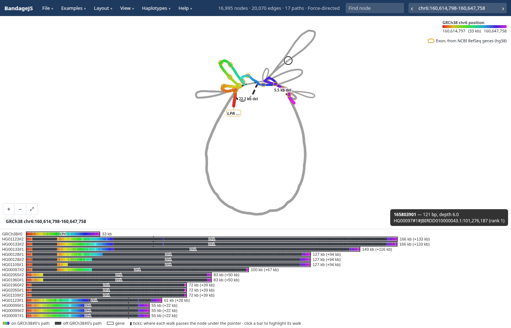
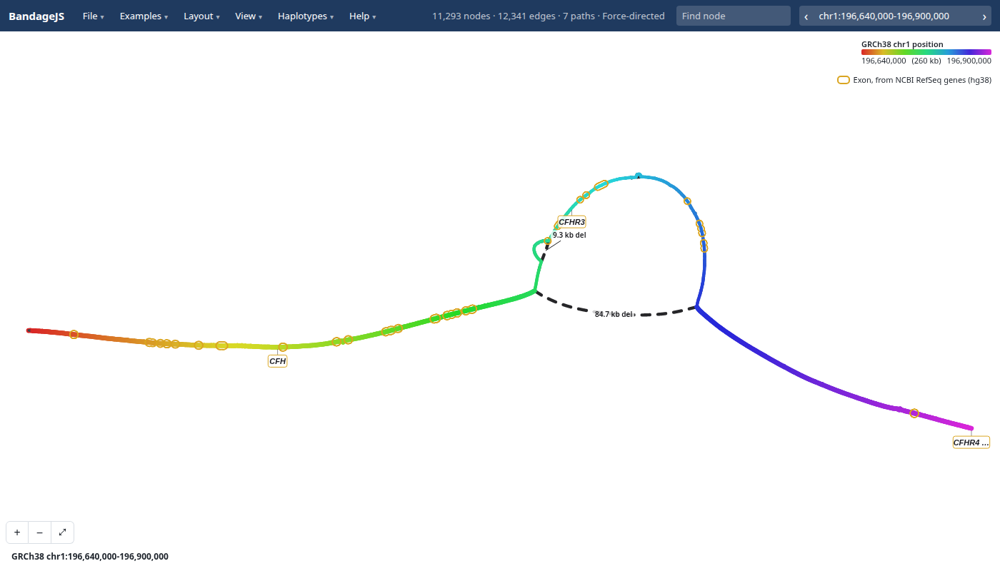
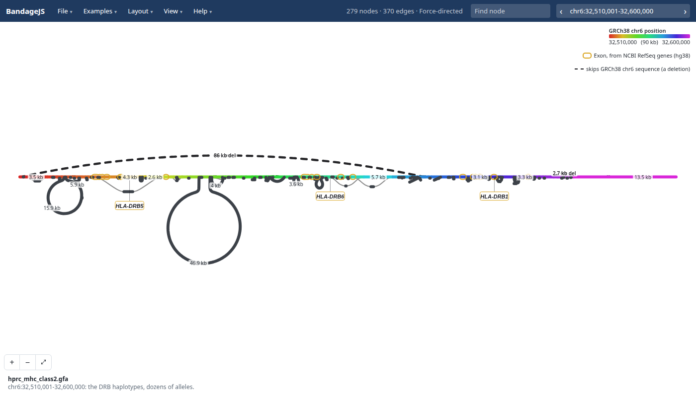
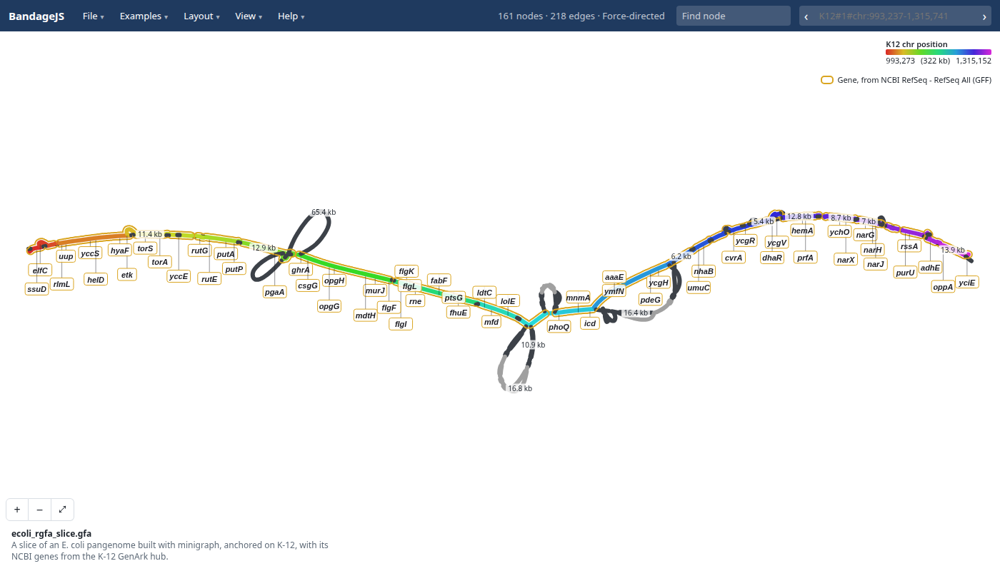
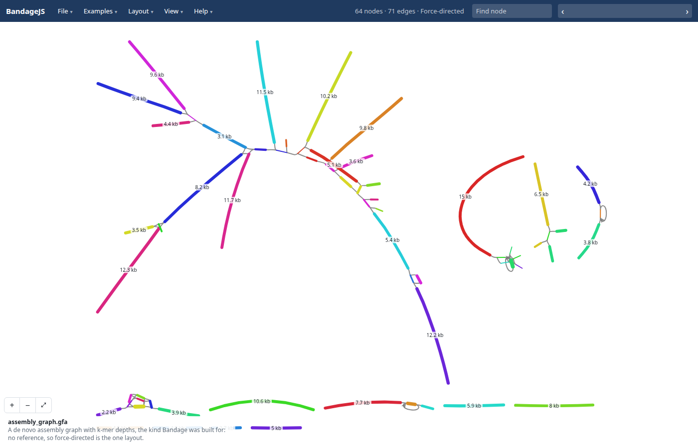

# BandageJS

BandageJS draws genome graphs in a web browser. Try it at
https://jbrowse.org/demos/bandagejs/, which opens on an example; the Examples
menu lists more.



The LPA gene in the HPRC human pangenome graph. Coloured nodes follow chr6 of
GRCh38, the human reference genome, from red to purple, and gold rings mark
LPA's exons. Dark grey nodes hold sequence that GRCh38 lacks, such as the 68.4
kb loop of extra KIV-2 repeat copies.

## Genome graphs

- A **genome graph** stores DNA as sequence segments (nodes) joined by links
  (edges). [GFA](https://gfa-spec.github.io/GFA-spec/GFA1.html) is its file
  format
- A **pangenome graph** holds many genomes, each haplotype as a **walk**: the
  list of segments it passes through. Where genomes differ, their walks take
  different branches
- [Bandage](https://github.com/rrwick/Bandage) draws de novo assembly graphs,
  and BandageJS opens those too. It also highlights walks, marks where they
  branch, draws genes on a reference genome, and reads one region at a time from
  a whole-genome pangenome

## Opening a GFA file

Drag a GFA file (`.gfa` or `.gfa.gz`) onto the page, or choose it in File →
Open. BandageJS loads the whole file, so this suits an assembly graph or a
pangenome graph of one region, like the examples. A whole-genome pangenome is
too large to load; see the next section.

## Opening a region of a whole-genome pangenome

1. Index the GFA once with [gfa-to-tabix](https://github.com/GMOD/gfa-to-tabix)
   1.4 or later. `--refs` names the genome whose coordinates you will search by:

   ```console
   gfa-to-tabix graph.gfa --walks --refs GRCh38 -o graph
   ```

   The command writes a walk file, `graph.GRCh38.walks.bed.gz`, and its index,
   `graph.GRCh38.walks.bed.gz.tbi`. A graph shipped as `.gbz`, as HPRC's are,
   converts to GFA first with `vg convert -f graph.gbz > graph.gfa`

2. Put both files on a web server that answers range requests and allows
   cross-origin reads, as Amazon S3 does
3. Paste the `.walks.bed.gz` url into File → Open, then type a region of the
   reference genome, such as `chr6:160,614,798-160,647,758`. BandageJS downloads
   only the part of the file in that region

The HPRC release 2 human pangenome is hosted already:
[open LPA from it](https://jbrowse.org/demos/bandagejs/?walks=hprc&loc=chr6:160,614,798-160,647,758&haps=HG00097,HG00133).
[Walk files](docs/walk-files.md) covers these steps with screenshots. BandageJS
also reads regions from a [gbz-base](https://github.com/jltsiren/gbz-base)
database (`.gbz.db`) the same way.

## Exploring and sharing

- Click a node for its details, or press `g` and type a region or gene name
- Pick a layout from the [Layout](docs/guide.md#layouts) menu, and highlight
  walks from the [Haplotypes](docs/guide.md#highlighting-haplotypes) menu
- File → Copy link shares the view, and File → Export SVG saves it

## Docs

- [User guide](docs/guide.md): layouts, highlighting haplotypes, genes and every
  address parameter
- [Walk files](docs/walk-files.md): making a walk file and opening a region of
  it, step by step

## Gallery

<table>
<tr>
<td><a href="docs/gallery.md"></a><br>Three walks overlaid on KIV-2</td>
<td><a href="docs/gallery.md"></a><br>Walk rows under the graph</td>
<td><a href="docs/gallery.md"></a><br>CFH with genes and a deletion</td>
</tr>
<tr>
<td><a href="docs/gallery.md"></a><br>MHC class II, stress layout</td>
<td><a href="docs/gallery.md"></a><br>E. coli with K-12 genes</td>
<td><a href="docs/gallery.md"></a><br>A de novo assembly graph</td>
</tr>
</table>

More in [the gallery](docs/gallery.md).

## See also

- [jbrowse-plugin-graphgenomeviewer](https://github.com/GMOD/jbrowse-plugin-graphgenomeviewer):
  draws pangenome graphs in JBrowse 2
- [ggbandage](https://github.com/GMOD/ggbandage) (R): Bandage-style figures as
  ggplot2 layers
- [JBrowse's HPRC pangenome tutorial](https://jbrowse.org/jb2/docs/tutorials/pangenome_hprc/)

## Libraries

- [gfa-to-tabix](https://github.com/GMOD/gfa-to-tabix): writes walk files
- [@jbrowse/graph-walks](https://github.com/GMOD/graph-walks) (npm): reads them
- [@jbrowse/bandage-core](https://github.com/GMOD/bandage-core) (npm): layout
  and drawing
- [@jbrowse/graph-stress-layout](https://github.com/GMOD/graph-stress-layout)
  (npm): stress layout

## License

GPL-3.0-or-later, building on [BandageNG](https://github.com/asl/BandageNG) and
[OGDF](https://www.ogdf.uni-osnabrueck.de/)
