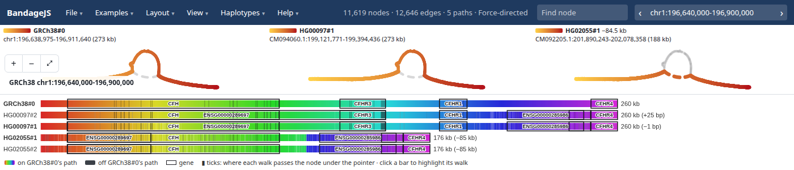
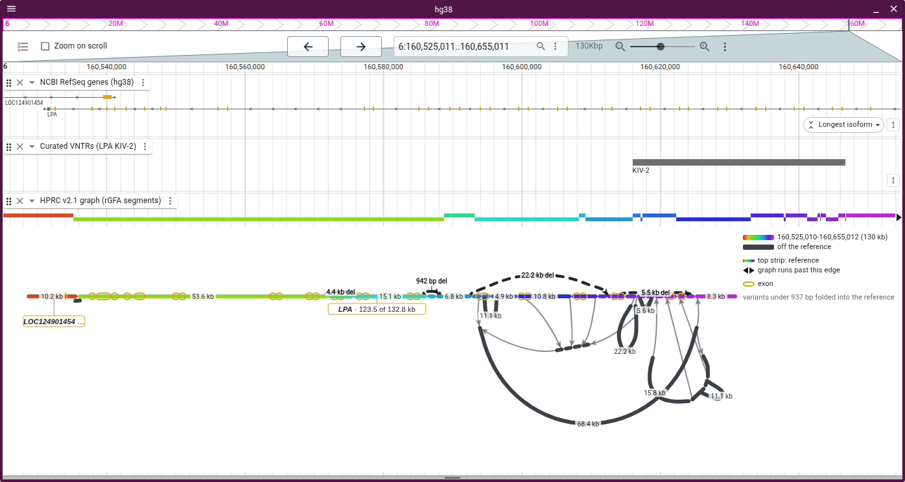
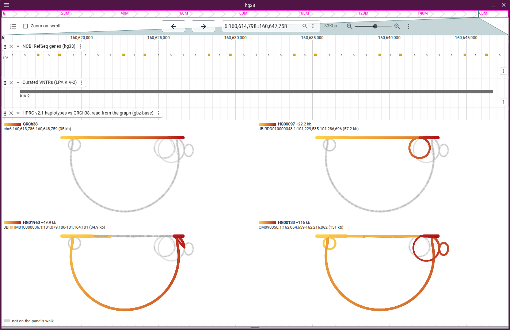

# Gallery

Three walks are overlaid on the KIV-2 repeat, one colour each. GRCh38 is
charcoal, HG00097#1 blue (22 kb longer) and HG00133#1 orange (116 kb longer).
Only HG00133#1 passes through the large loop:

Walk rows for eight HPRC samples sit under the LPA KIV-2 graph. With the pointer
on HG01123#2's bar, BandageJS rings the node at that position, and ticks mark
where the other walks pass that node:

The CFH locus and its CFHR genes are drawn for three HPRC samples. An 84.7 kb
deletion edge skips CFHR3 and CFHR1; HG02055 and HG01123 take it, and HG00097
does not:

CFH is drawn with one panel per walk. GRCh38 and HG00097#1 take the loop through
CFHR3 and CFHR1. HG02055#1 takes the 84.5 kb deletion edge instead:

The amylase locus is drawn as walk rows for four HPRC samples, with CAT genes
boxed. The boxes count AMY1 copies: one at 146 kb, two at 168 kb, three at 240
kb (as in GRCh38) and four at 318 kb. Charcoal marks a stretch off GRCh38's
path, a thin line a gap whose bases the graph lacks (19 kb in HG00097#1), and
"partial walk" a walk that leaves the cut region:

The stress layout draws HLA-DRB5, DRB6 and DRB1 from a slice of an HPRC rGFA.
The dashed edge is an 86 kb deletion, and the large loop is 46.9 kb of sequence
that the reference lacks:

A slice of an E. coli minigraph is anchored on K-12 and labelled with K-12's
genes:

The tube map draws five E. coli strains through a pggb graph:

BandageJS also opens the de novo assembly graphs that Bandage draws, coloured
per contig:

## In JBrowse 2

Pangenome graphs also open in JBrowse 2 through
[jbrowse-plugin-graphgenomeviewer](https://github.com/GMOD/jbrowse-plugin-graphgenomeviewer).
Here the KIV-2 repeat sits under the RefSeq genes and a curated annotation, and
the strip above the graph uses the tracks' genome coordinates:

JBrowse draws the KIV-2 repeat with one panel per walk. HG00097 has 22 kb more
sequence than GRCh38, HG01960 has 50 kb more and HG00133 has 116 kb more:

