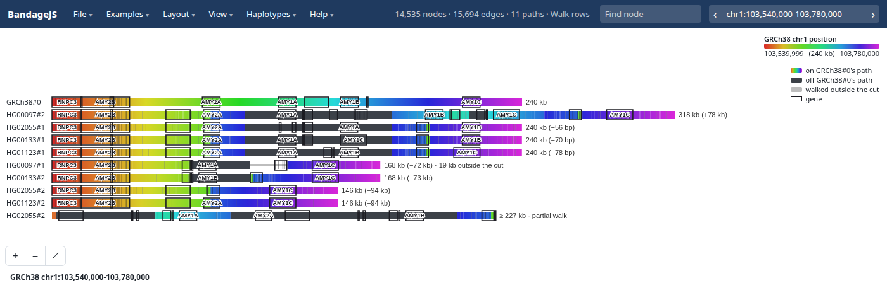
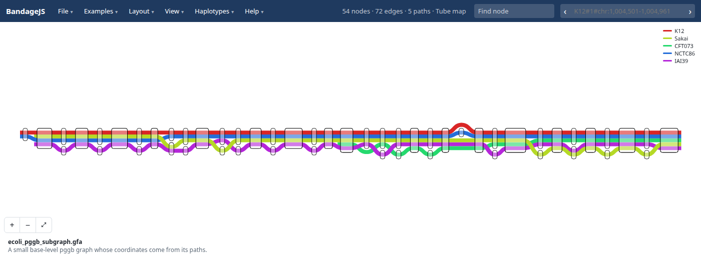

# Gallery

The amylase locus in four HPRC samples as walk rows, boxed with CAT genes. The
boxes count AMY1 copies: one at 146 kb, two at 168 kb, three at 240 kb (as in
GRCh38) and four at 318 kb. Charcoal marks a stretch off GRCh38's path:

LPA KIV-2 in eight HPRC samples. Pointing at HG01123#2's bar rings its node in
the graph, and ticks mark where the other walks pass it:

Five E. coli strains through a pggb graph, as a tube map:

BandageJS also opens the de novo assembly graphs that Bandage draws, coloured
per contig:

