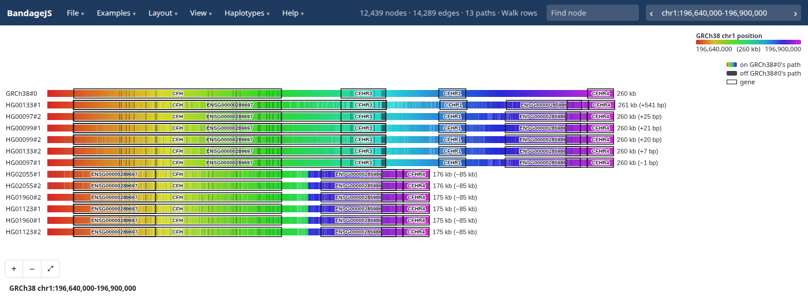
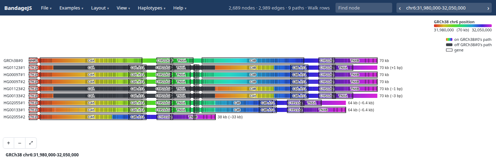

# Gallery

CFH and its CFHR genes in six HPRC samples as walk rows. Six of the twelve
haplotypes lack 85 kb, and with it CFHR3 and CFHR1:

The amylase locus in four HPRC samples as walk rows, boxed with CAT genes. The
boxes count AMY1 copies: one at 146 kb, two at 168 kb, three at 240 kb (as in
GRCh38) and four at 318 kb. Charcoal marks a stretch off GRCh38's path:

The complement C4 region in four HPRC samples. HG02055#2 is 33 kb short, and
two haplotypes lose 6.4 kb. Where C4A and C4B swap, the bars change colour:

LPA KIV-2 in eight HPRC samples. Pointing at HG01123#2's bar rings its node in
the graph, and ticks mark where the other walks pass it:

A slice of an E. coli minigraph, anchored on K-12 and labelled with its genes:

Five E. coli strains through a pggb graph, as a tube map:

BandageJS also opens the de novo assembly graphs that Bandage draws, coloured
per contig:

