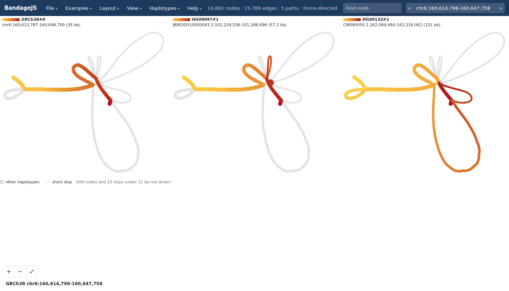

# User guide

This page covers the menus. The in-app Help → **User guide** lists the mouse,
touch and keyboard controls.

## Walks and the reference

- **Walks** are a GFA's P or W lines
- **The reference** comes from rGFA `SN`/`SO`/`SR` tags, or else from the first
  walk in the file. Haplotypes → **Reference haplotype** picks another walk, and
  genes then come from that walk's assembly

## Layouts

The Layout menu lists the layouts the open graph can draw and leaves out the
rest. The address holds the choice as `layout=`.

- **Force-directed**, for every graph, in two engines:
  - **FMMM**, the default: Bandage's own layout, OGDF's fast multipole
    multilevel method compiled to wasm
  - **Stress:** draws the reference straight and places each variant against it:
    an allele as a lens, a repeat loop as a ring, a deletion as an arch. A
    component with no reference gets plain stress, by stochastic gradient
    descent
- **Anchored** (needs a reference): x at reference bp, one row per stable rank
- **Sample rows** (needs a reference and a segment off it): x at reference bp,
  one row per contributing assembly. Where an assembly has a deletion, its row
  is empty across the deleted span
- **Walk rows** (needs a reference and two or more walks): one bar per
  haplotype, x along that haplotype's own bp, blue where the walk follows the
  reference and purple off it, so a repeat expansion shows as a longer bar. When
  genes are loaded, each bar has boxes for that haplotype's genes
- **Ordered** (needs a reference): x in reference order, not bp, with each node
  as wide as the log of its length, so a SNP allele stays visible beside a 10 kb
  segment and a bubble is drawn as a lens shape
- **Tube map** (needs a walk): each walk as a coloured tube through boxed nodes,
  as [sequenceTubeMap](https://github.com/vgteam/sequenceTubeMap) does, with
  columns in node order and log-scaled node widths. No genes
- **Tube map on reference** (needs walks and a reference): the tube map with
  each column at the reference bp it covers

Haplotypes → **Bars under the graph** draws the walk rows beneath any layout
except walk rows and the tube maps.

View → **Node lengths** writes each node's bp on it, where there is room, in the
layouts that draw nodes. It is off by default. Two lengths are written either
way. A "nodes not shown" placeholder states its length on its loop, or stacked
off the loop's middle with a leader, longest first, where its whole label fits
on the pane; placeholders whose middles lie closer together than a label is tall
share one length, the longest. A loop of loaded nodes, what a walk steps on
between two steps on the reference, writes its length along itself where it is
drawn long enough to hold it; a loop sharing half its bp with a longer one is
drawn over it, and the longer writes the span of both, such as `20.5–20.9 kb`.
The key's "nodes not shown" row counts the placeholders left without a length,
and hovering it gives their lengths.

View → **Small sites** draws every node and skip at any zoom. It is off by
default: a stretch off the reference or a skip drawn only a few pixels long at
the current zoom, its own nodes and links with the reference between where it
attaches, is left out and the reference runs straight through it. A stretch the
cut did not load is measured by its bp at the reference's scale where that is
shorter. The key's last line counts the nodes and skips left out where the pane
shows and the bp they are under, and zooming in draws each site again. A site
left out is neither hovered, selected nor labelled; finding a node there, or a
link naming it, zooms in until it is drawn.

The key lists what the pane shows, the drawing under the key included, and
nothing else: a mark, an exon or a node thickness off the pane is not keyed. It
is read again once a pan or zoom comes to rest.

### Layout settings

Layout → **Layout settings…** opens a dialog:

- **Node thickness** and **Width by depth**, for every layout. Width by depth is
  greyed out when every node has the same depth
- **Force-directed** settings, shown when the layout on screen comes from the
  force engine: **Engine**, **Quality** (Fastest to Best), **Bubble spread**,
  **Spacing** and **Component separation**
- **Bubble spread** sets how a node's bp becomes drawn length: Proportional
  (Bandage's scale), Open or Wide bubbles (a minimum length for every allele),
  or Compress lengths (long and short nodes pulled towards the mean)
- **Reset** restores the defaults
- A force setting lays the graph out again when its slider is released, and
  Layout → **Rerun layout** does so on demand

## Highlighting haplotypes

The Haplotypes menu highlights walks, and the rest of the graph fades to grey.

- A single highlighted walk is shaded light to dark along its length
- Several walks, with **None** selected, overlay in one drawing, each walk in a
  flat colour and a separate lane
- **A panel per walk** draws one panel per walk on a shared gradient, yellow at
  the start and red at the end
- **A row per sample** puts each sample in a row and each haplotype in a column
- **Colour highlighted…** picks what a lane shows and the palette. **Each pass
  through repeated nodes** splits a walk's lane into one thread per visit, names
  each pass beside its thread, and draws the walk along its own length under the
  drawing with each pass's stretches in its colour
- **Clear highlights** removes them

Panels share one view, so a pan, zoom or hover in one applies to all. Click a
panel's title to highlight that walk alone. `columns=` in a link sets how many
panels go across.

Through the LPA KIV-2 array, HG00097 has 22 kb more sequence than GRCh38 and
HG00133 has 116 kb more:



The address holds the walks and the facet:

```
?walks=hprc&loc=chr6:160,614,798-160,647,758&haps=HG00097,HG00133&walk=GRCh38%230%23chr6&walk=HG00133%231%23CM090050.1&facet=walk&columns=2
```

## Genes

BandageJS draws genes along the reference nodes, with exons dark and each gene's
name beside it. Hover a name for the span and strand. Genes appear in the
force-directed, anchored, ordered and sample-row layouts, and on walk rows.

- **Which assembly:** a graph's reference sample has a name such as
  `GRCh38#0#chr6`, and `chr6` exists in every human assembly. The page matches
  the sample to an assembly in its JBrowse hubs by name or alias, then reads
  that assembly's gene track, so most graphs need no setup
- **When nothing matches,** File → **Choose reference genome…** picks from the
  assemblies whose sequence names fit the reference, or searches every genome on
  genomes.jbrowse.org by name (`thale cress`), GenArk accession
  (`GCF_000005845.2`) or UCSC name (`mm39`). The browser remembers the choice
  for that sample; pick Automatic to forget it
- **Walk rows:** each bar is boxed with genes from the assembly named for its
  haplotype (`HG00097#1`), if the hub has one. The HPRC portal has them for
  every release 2 haplotype. Click a bar for a link to that span in JBrowse
- **Your own genes:** File → **Open genes…** reads a GFF3 or BED file, plain or
  gzipped. It needs no assembly, only contig names that match the graph's
  (`chr6` or `GRCh38#0#chr6`)
- **Site setup:** a deployer lists the hubs the page searches in `config.json`;
  see [developing.md](developing.md#gene-hubs)

## Links

The address always describes the view on screen, and File → **Copy link** copies
it. A graph opened from your computer has no link. A parameter appears only when
it differs from the default.

| Parameter                                                   | Meaning                                                                              |
| ----------------------------------------------------------- | ------------------------------------------------------------------------------------ |
| `gfa`                                                       | GFA url                                                                              |
| `walks`, `loc`, `ref`, `haps`                               | Cut: walk file url (or `hprc`), region, reference sample, comma-separated haplotypes |
| `expand`                                                    | Abridged walks the cut reads in full, comma-separated `sample#haplotype#contig`      |
| `hub`, `assembly`, `contigs`                                | Genes: JBrowse configs, assembly, `graph:assembly` contig names                      |
| `layout`                                                    | `force`, `anchored`, `ordered`, `samplerows`, `walkrows`, `tubemap` or `tubemapref`  |
| `along`                                                     | Walk that a walk-anchored graph draws along                                          |
| `walk`                                                      | Highlighted walk, repeated per walk                                                  |
| `facet`, `columns`                                          | `none`, `walk` or `sample`; panels across                                            |
| `node`                                                      | Selected node                                                                        |
| `view`                                                      | `x,y,scale` at the pane's centre; absent when fitted                                 |
| `color`, `width`, `thickness`                               | Colour scheme, `depth` or `uniform` width, node width in px                          |
| `bubbles`, `deletions`, `genes`, `lengths`, `paths`, `bars` | `1` or `0` for each drawn element                                                    |
| `smallsites`                                                | `1` draws every node and skip at any zoom                                            |
| `engine`, `quality`, `spacing`, `separation`, `spread`      | Force layout settings                                                                |
| `gbz`, `index`                                              | Older links: a gbz-base `.gbz.db` cut and its haplotype index                        |

`loc` reads 1-based and closed, as JBrowse writes a locus:
`chr6:160,614,798-160,647,758`, or `chr6:160,614,798` for one base.
