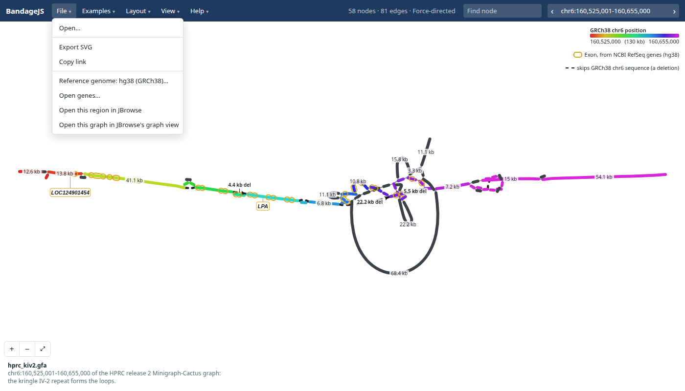
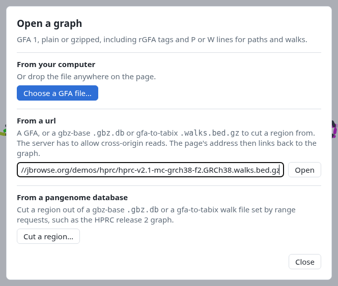
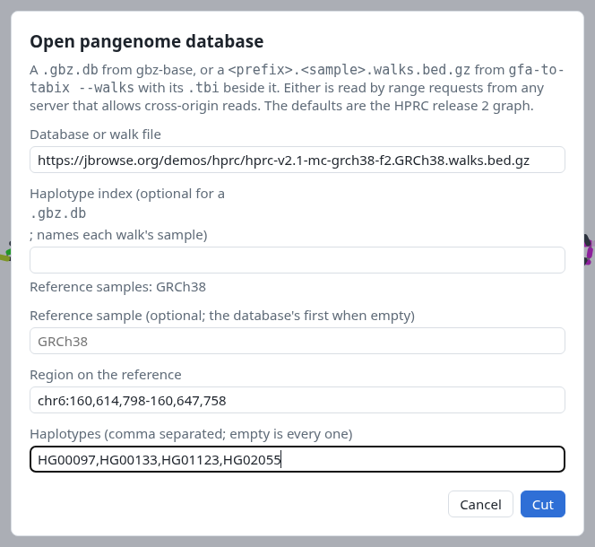
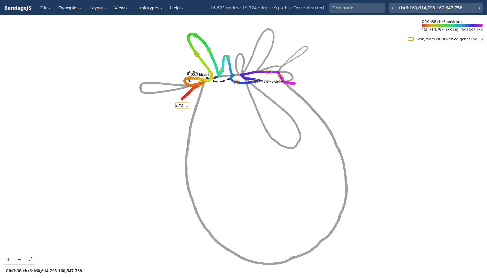
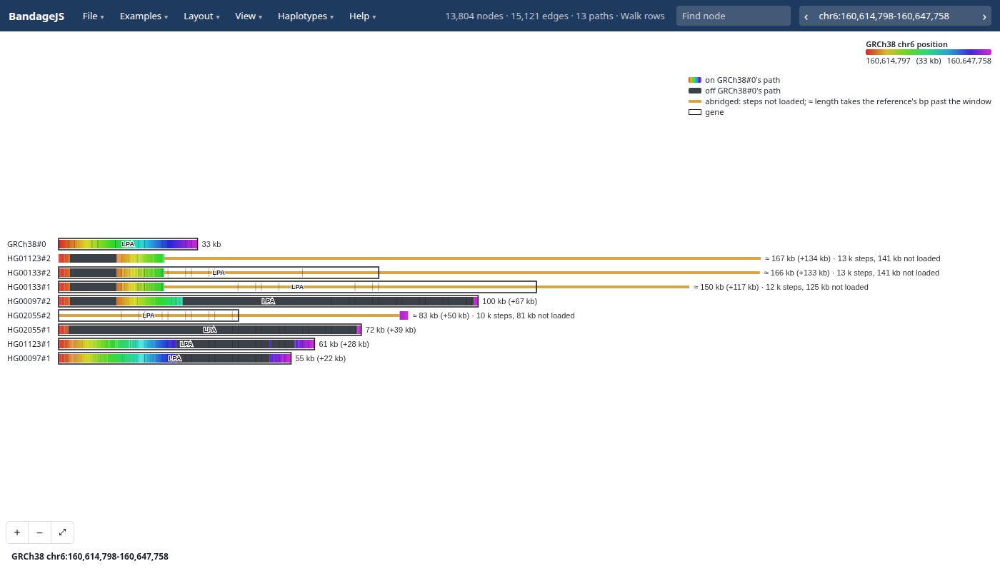

# Walk files

- **In:** a pangenome graph as GFA, indexed by
  [gfa-to-tabix](https://github.com/GMOD/gfa-to-tabix) `--walks`
- **Out:** one region of the graph in the browser, with each haplotype's walk
  through it

[gfa-to-tabix](https://github.com/GMOD/gfa-to-tabix) `--walks` indexes every
haplotype's path by reference chunk. A cut reads the chunks under the window and
needs no haplotype index. The screenshots cut the KIV-2 repeat in _LPA_ from the
hosted HPRC release 2 walk file.

## 1. Index the graph

```console
gfa-to-tabix graph.gfa --walks --refs GRCh38 -o graph
```

- The run writes `graph.GRCh38.walks.bed.gz` and `graph.GRCh38.walks.bed.gz.tbi`
- BandageJS needs walk format 5, from gfa-to-tabix 1.4 or later
- A graph shipped as `.gbz` converts first:
  `vg convert -f graph.gbz > graph.gfa`

## 2. Host both files

- Put the `.walks.bed.gz` and its `.tbi` side by side under one url
- The server must answer range requests and send `Access-Control-Allow-Origin`,
  as S3 does
- BandageJS fetches the chunks under the region by range request, so the 1.5 GB
  HPRC file opens without a download

## 3. Paste the url into Open

Choose File → **Open…**:



Paste the `.walks.bed.gz` url under **From a url** and press **Open**:



## 4. Choose the region and haplotypes

BandageJS recognises the `.walks.bed.gz` name and opens the cut dialog. Once it
reads the file's header, the dialog lists the reference samples under the walk
file field.



- **Reference sample:** leave empty to use the file's first, here GRCh38
- **Region:** 1-based and closed, on the reference, as JBrowse writes it
- **Haplotypes:** sample names, comma separated; empty keeps every one

**Cut** draws the region. Where the region holds too many nodes, the error
message gives a window size that fits.

## 5. Read the graph



- Colour runs along the GRCh38 path, red to purple; grey nodes lie off it
- Gold rings mark RefSeq exons, read for the reference genome BandageJS matched
- Dashed edges labelled `22.2 kb del` skip that much of the reference
- The grey loops lie off the GRCh38 path: KIV-2 copies GRCh38 lacks

## 6. Compare the haplotypes

Under Layout → **Walk rows**, BandageJS draws each walk as a bar as long as the
haplotype's bp:



- Coloured stretches follow the reference; dark stretches are sequence GRCh38
  lacks
- The label after each bar gives the walk's length and its difference from the
  reference: HG00133#1 runs 116 kb longer than GRCh38's 33 kb
- [Haplotypes](haplotypes.md) covers highlighting walks and panels

## 7. Share the cut

The address holds the whole cut, so File → **Copy link** shares it:

```
?walks=hprc&loc=chr6:160,614,798-160,647,758&haps=HG00097,HG00133,HG01123,HG02055&layout=walkrows
```

`hprc` stands for the HPRC release 2 file,
`https://jbrowse.org/demos/hprc/hprc-v2.1-mc-grch38-f5.GRCh38.walks.bed.gz`; a
link to your own file holds its url.

[Links](links.md) lists every parameter.

## Abridged walks

- gfa-to-tabix moves the costliest walks of a costly chunk, usually a
  satellite array, into detail records that a window read skips
- BandageJS reads each such walk as two steps, where it leaves and rejoins the
  reference
- The Haplotypes menu lists each as a block, such as
  `HG00133#1: 11 k steps, 171 kb off reference`. Walk rows draw its missing
  steps in amber
- Clicking the block, or **Load its steps** on a selected walk row, cuts again
  with the walk read in full
- A highlighted walk is read in full, since BandageJS needs its steps to draw
  the highlight. One that would take the cut past its budgets stays abridged,
  with a notice
- `expand=` in the address lists the walks read in full. The budgets still
  apply, so a click that expands past them fails as a too-wide window does

[@jbrowse/graph-walks](https://github.com/GMOD/graph-walks) reads the files.
